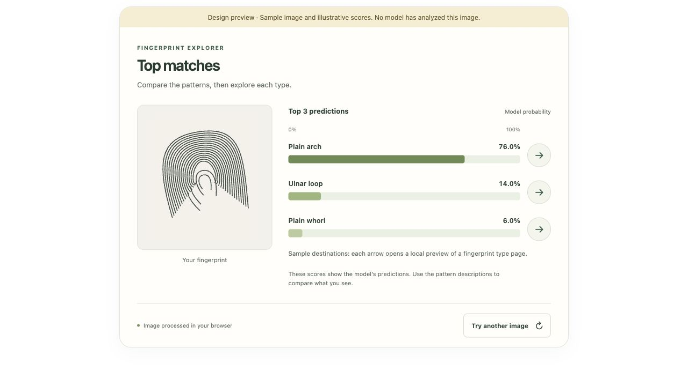
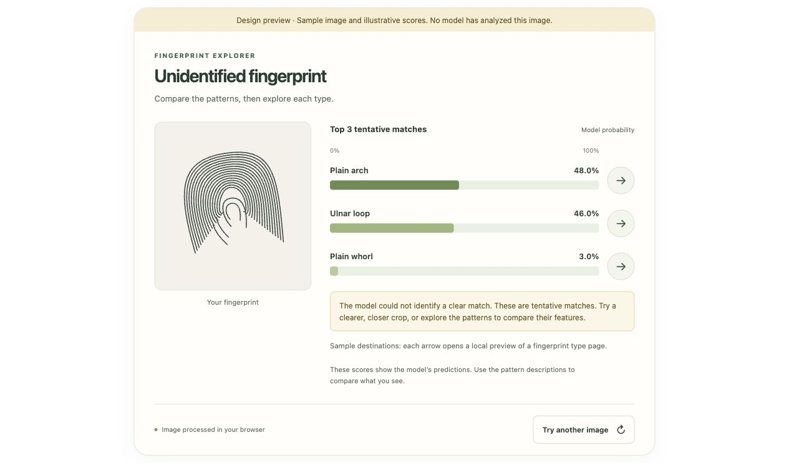
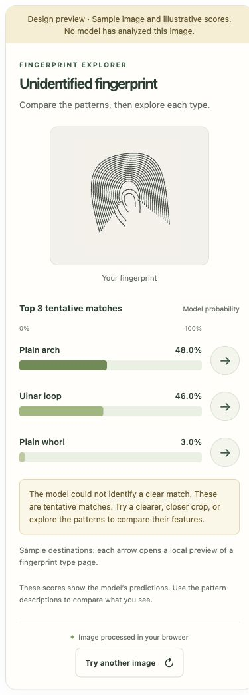
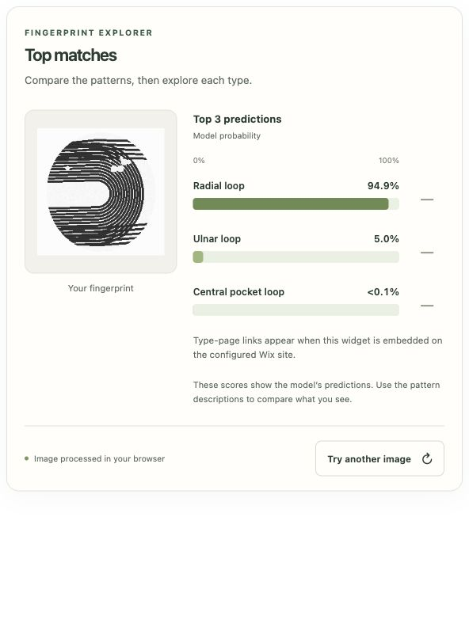

# Client review

Run `python3 -m http.server 8000` from the repository root, then open
<http://localhost:8000/preview/>. The scenario chooser links to clear, close,
diffuse and two-class sample outputs. Each sample explicitly labels its invented
scores. The arrows open a sample destination; actual Wix navigation needs the
published site and its configured category pages.

## What to decide

- Does the image-left, probabilities-right layout communicate the result clearly?
- Are three choices, with an arrow beside each, useful for students?
- Is the unidentified message clear while still allowing exploration?
- Is a teacher-managed result layout acceptable, with students designing their
  individual Wix category pages? Or should students design the result chart too?

## Verification

The dependency-free widget tests cover ranking, original score widths, tiny
percentages, uncertainty boundaries, two classes, navigation validation, image
cleanup, stale requests, loading/retry, preview mode and required HTML elements.

Browser checks covered the sample category arrow, desktop clear/unidentified
results, stacked mobile results, an intermediate width, leaving sample mode,
actual model initialization, upload/inference and reset. Mobile and intermediate
layouts showed no horizontal overflow. The actual model test used the generated
`eight-class-smoke/held-out-test/Radial loop/synthetic-01.png` from the adjacent
course dataset: a placeholder drawing, not a person's fingerprint. It produced
Radial loop 94.9%, Ulnar loop 5.0%, Central pocket loop <0.1%; this verifies the
plumbing, not classification accuracy.

The screenshot images below were captured from the local browser. No Wix site
was changed or published. Published Wix referrer/navigation and final iframe
height still require verification in the intended site and browsers.

## Screenshots

Clear sample:

Unidentified sample:

Mobile unidentified sample:

Actual model inference with the synthetic placeholder:

