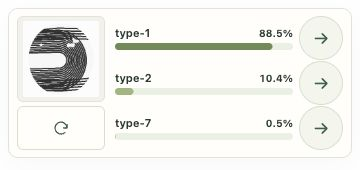

# Isolated top-three widget trial

This is the top-three widget snapshot at `1e0b96a`, plus the client
`demo-c` export from `client-set-224/tm-my-image-model.zip`, packaged under
`trials/top-three/`. Only this directory is added to
`main`; the existing root widget and its models remain unchanged. This snapshot
does not automatically track later feature-branch changes.

## Publish the preview

The repository's GitHub Pages settings currently publish `main` from `/` using
GitHub's generated `pages-build-deployment` workflow. Merge the preview-only PR
and wait for that Pages run to succeed. Feature PR #5 has already been merged into the root widget; this trial remains
a separate path. No Pages setting or workflow change is
needed. The existing `.nojekyll` applies to this directory too.

| Purpose | URL |
| --- | --- |
| Existing widget, unchanged | https://linus-bucket-apps.github.io/fingerprint-web-app-widget/?model=demo-c |
| Trial with actual inference | https://linus-bucket-apps.github.io/fingerprint-web-app-widget/trials/top-three/?model=demo-c |
| Sample scenario chooser | https://linus-bucket-apps.github.io/fingerprint-web-app-widget/trials/top-three/preview/ |

The trial URLs become available only after the preview PR is merged and Pages
deployment succeeds. A feature branch alone does not receive a separate Pages URL
in this configuration. Future deployments preserve the preview as long as this
directory remains in the published tree.

## Quick Wix setup

1. Duplicate the upload page as a test page so the current visitor flow remains
   available. Keep the old embed on the original page.
2. On the test page, choose **Embed a Site**, then **Enter Website Address**, and
   paste the actual-inference trial URL above. Use `?model=demo-c` without a
   `preview` parameter for real image tests. Apply the change.
3. Use the original widget’s **360 × 170 px** embed size for upload and normal
   results. The trial stays side by side at narrow widths; the image and reset
   share the left column, and three 44 px arrow targets fit on the right. Long
   labels truncate visually, with the full label on hover and for screen readers.
   Setup/error messages can require more height, as with the original widget.
4. Use normal Wix category pages whose slugs match `models/catalog.json`:
   `type-1`, `type-2`, `type-3`, `type-4`, `type-5`, `type-6`, `type-7`, `type-8`.
   Each model label maps to the identical slug; no named-category mapping is assumed.
   Existing pages with these slugs can be reused. `demo-a` and `demo-b` remain available.
5. Check the site's base path. `widget.js` currently uses
   `CONFIG.wixSiteBasePath = "/fingerprint/"`. For a site published at
   `https://name.wixsite.com/my-site-1`, change that value in this trial's
   `widget.js` to `"/my-site-1/"` before merging. The new directory on GitHub is
   unrelated to the Wix site base path. Navigation currently accepts only HTTPS
   `.wixsite.com` referrers, not custom or Wix Studio domains.
6. This widget handles upload, results and unidentified cases internally. The test
   page needs no CMS, separate Wix results cards, conditional rendering or Velo
   messaging code. If copied page code uses an old embed listener/handshake,
   remove that integration from the test page; keep unrelated page logic.
7. Publish the Wix test page and test a clear result, an unidentified result,
   restart, and each category arrow. Test on the published page rather than only
   Wix Preview. Category arrows open a new tab using `target="_blank"` and
   `rel="noopener"`, matching the original widget. Wix's embed allows popups but
   blocks top-level (`_top`) navigation. Tooltips and accessible names indicate
   that a category opens in a new tab. Sample/local destinations use `_self`.

On localhost, real classification arrows open sample category placeholders for
review. On GitHub Pages opened directly, there is no trusted Wix referrer, so the
image/model work but category arrows are disabled. The `preview/` scenario pages
use invented scores and sample destinations; these are separate from real tests.

## Verify locally

From the repository root:

```sh
python3 -m http.server 8000
node --test trials/top-three/tests/widget.test.mjs
```

Open `http://localhost:8000/trials/top-three/?model=demo-c`. The packaged catalog,
model weights, CSS, JavaScript and sample assets use paths inside this trial, so
the root widget can retain its current files independently.

The demo-c export's weights and labels were checked against its manifest, and
browser loading, inference and a numbered sample destination were verified. The
screenshot below uses a generated abstract smoke fixture for plumbing only; it
does not establish numbered-to-named category mappings or model accuracy.



Unidentified results show a retry message with the image and restart button;
scores and category arrows are hidden. The experimental rule rejects a leading
score below 50% or a lead below 15 percentage points. The numbered model has no trained
unknown class, so unrelated images with high scores can still pass this rule.

References: [GitHub Pages publishing sources](https://docs.github.com/en/pages/getting-started-with-github-pages/configuring-a-publishing-source-for-your-github-pages-site),
[Wix site embeds](https://support.wix.com/en/article/wix-editor-embedding-a-site-or-a-widget).
